# Lab 10 - Внутренний GitLab команды: единый вход, nginx-рубеж и раннеры

Развертывание и защита внутренней платформы разработки: единый вход через Keycloak, защита периметра внешним nginx, настройка CI/CD со статическими и эфемерными раннерами, а также мониторинг GitLab.

## Что это

Продолжение Лабы 1. Мы разворачиваем центр платформы разработки для сервиса «Пальчики оближешь». В этой лабе:

- GitLab CE и Keycloak в Docker Compose.
- Единый вход (SSO) по протоколу OIDC для GitLab и Grafana.
- Внешний nginx как reverse proxy с TLS-терминацией и правилами ограничения доступа.
- CI/CD пайплайн со статическим и эфемерным раннерами.
- Мониторинг GitLab через Prometheus и Grafana.

Вся инфраструктура развернута на домашнем сервере (LXC-контейнер), сервисы общаются через общую Docker-сеть `monitoring-net`.

## Что поднято

| Компонент | Роль | Домен / Порт |
|-----------|------|--------------|
| gitlab | Платформа разработки (код, CI/CD, registry) | sso.local (443) |
| keycloak | Identity Provider (SSO, OIDC) | keycloak.local:18080 |
| grafana-lab10 | Визуализация метрик | grafana.local (443) |
| nginx-edge | Внешний reverse proxy и защита | 80 / 443 |
| gitlab-runner-static | Статический раннер (docker executor) | - |
| gitlab-runner-dynamic | Эфемерный раннер (docker executor) | - |
| prometheus | Сбор метрик | prometheus.local (443) |
| alertmanager | Маршрутизация алертов | 9093 |

## Настройка локального окружения (файл hosts)

Мы используем вымышленные домены (`sso.local`, `grafana.local` и т.д.) для удобной работы.

Поскольку вся инфраструктура развернута на удаленном сервере (и мы подключаемся к ней через SSH-туннель на локальные порты 80 и 443), нужно указать в файле `hosts` на ноутбуке, что все эти домены на самом деле ведут на локальный адрес `127.0.0.1`.

Что именно прописывается (Windows):
На ноутбуке в файле `C:\Windows\System32\drivers\etc\hosts` (изменять нужно с правами администратора) добавлены следующие строки:

```text
127.0.0.1 sso.local
127.0.0.1 grafana.local
127.0.0.1 keycloak.local
127.0.0.1 prometheus.local
```

## Часть 1. Единый вход (Keycloak + OIDC)

Для доступа к инструментам настроен единый вход. GitLab и Grafana не хранят пароли, а делегируют проверку Keycloak.

Основные сущности:
- Realm `shop`: изолированное пространство пользователей.
- Clients `gitlab` и `grafana`: приложения, которым разрешено использовать Keycloak для входа.
- Тестовый пользователь: `testuser`.

Как это работает по шагам:
1. Пользователь открывает `https://sso.local` и нажимает «Sign in with Keycloak».
2. GitLab перенаправляет браузер на `http://keycloak.local:18080` с параметрами (client_id, redirect_uri).
3. Пользователь вводит логин и пароль в Keycloak. Keycloak возвращает GitLab одноразовый код (authorization code).
4. GitLab (уже на бэкенде, по внутреннему адресу `http://keycloak:8080`) обменивает код на токен и получает данные пользователя.
5. GitLab создает сессию и пускает пользователя.

Важный нюанс: браузер ходит по внешнему адресу `keycloak.local:18080`, а контейнеры GitLab и Grafana - по внутреннему `keycloak:8080`. Это реализовано через параметр `KC_HOSTNAME_BACKCHANNEL_DYNAMIC` в Keycloak.

## Часть 2. nginx как рубеж перед GitLab

Внешний nginx (`nginx-edge`) принимает весь трафик из интернета и терминирует TLS (самоподписанный сертификат).

Самоподписание сертификата:
```
openssl req -x509 -nodes -days 365 -newkey rsa:2048 \
  -keyout server.key -out server.crt \
  -subj "/CN=sso.local" \
  -addext "subjectAltName=DNS:sso.local,DNS:grafana.local,DNS:keycloak.local,DNS:prometheus.local,DNS:localhost,IP:127.0.0.1"
```

Реализованные правила защиты:
1. Редирект с 80 на 443 порт.
2. Закрытие служебных эндпоинтов: доступ к `/-/health`, `/-/metrics` и т.д. извне заблокирован (`deny all`).
3. Ограничение админ-зоны: путь `/admin` доступен только из внутренней сети Docker (`allow 172.16.0.0/12; deny all;`).
4. Маршрутизация по доменам: `sso.local` идет в GitLab, `grafana.local` - в Grafana.

Для реального GitLab это критически важно, так как скрывает внутреннюю служебную информацию и защищает административную панель от брутфорса и внешних атак.

## Часть 3. CI/CD: Статические и эфемерные раннеры

Распределение задач (обоснование):
- Статический раннер (`static`): используется для быстрых задач (линтеры, проверка импортов). Задачи короткие (10-30 сек), поэтому держать постоянно работающий раннер с кэшем выгоднее, чем ждать запуска нового контейнера.
- Эфемерный раннер (`dynamic`): используется для ресурсоемкой сборки и пуша Docker-образа. Задача долгая, требует чистого окружения и много ресурсов. Эфемерный раннер создает контейнер под задачу и удаляет его после.

Особенность реализации в LXC:
Полноценный Kubernetes executor (через kind/minikube) в LXC-контейнере не запускается из-за ограничений cgroups и namespaces. Поэтому эфемерность реализована через Docker executor с параметрами `disable_cache = true` и `pull_policy = always`. Это дает чистое окружение на каждую задачу и не оставляет простаивающих ресурсов.

Пайплайн:
Задачи `lint` и `test` идут параллельно на статическом раннере. Сборка `build-and-push` запускается после них на эфемерном раннере. Сборка использует Docker-демон хоста (через проброс сокета) и пушит образ в GitLab Container Registry по внутреннему адресу `127.0.0.1:5000`.

## Часть 4. Мониторинг GitLab

Для мониторинга выбран сам GitLab. Включены встроенные экспортеры:
- Puma (порт 8083) - метрики веб-сервера.
- Sidekiq (порт 8082) - метрики фоновых задач.
- GitLab Exporter (порт 9168) - системные метрики.

Дашборд:
- `GitLab Up` (`up{job=~"gitlab-.*"}`) - статус доступности.
- `Sidekiq queue size` (`sum(sidekiq_queue_size)`) - длина очереди фоновых задач.
- `Puma queued connections` (`sum(puma_queued_connections)`) - очередь соединений.
- `HTTP requests rate` - интенсивность запросов.

Три алерта:
1. GitLabDown: `up{job=~"gitlab-.*"} == 0` (1 минута). Ловит полную недоступность. Грозит остановкой CI/CD и разработки.
2. GitLabSidekiqQueueHigh: `sum(sidekiq_queue_size) > 100` (5 минут). Ловит затор фоновых задач. Грозит зависанием пайплайнов.
3. GitLabPumaQueueHigh: `sum(puma_queued_connections) > 20` (5 минут). Ловит перегрузку веб-сервера. Грозит замедлением работы и ошибками 502.

## Как запустить

```bash
docker network create monitoring-net   # один раз
cd lab10
docker compose up -d --build
docker compose ps
```

Первый запуск GitLab занимает 5-7 минут.

## Подключение к серверу

```bash
ssh -L 80:localhost:80 \
    -L 443:localhost:443 \
    -L 18080:localhost:18080 \
    -L 2222:localhost:2222 \
    -L 5000:localhost:5000 \
    -L 19090:localhost:9090 \
    -L 13001:localhost:3001 \
    -o ServerAliveInterval=30 \
    prj@cloud-infrastructure.yetti
```

## Структура репозитория

```text
lab10/
├── README.md
├── report.md
├── docker-compose.yml
├── alertmanager/
│   └── alertmanager.yml
├── gitlab-runner-dynamic/
│   └── config.toml
├── gitlab-runner-static/
│   └── config.toml
├── nginx/
│   ├── certs/
│   │   ├── server.crt
│   │   └── server.key
│   ├── gitlab.conf
│   └── proxy_params_gitlab.conf
├── prometheus/
│   ├── alerts.yml
│   └── prometheus.yml
└── screenshots/
    ├── admin403.png
    ├── health403.png
    ├── build-and-push.png
    ├── gitlab-keycloak-1.png
    ├── gitlab-keycloak-2.png
    ├── grafana-keycloak-1.png
    ├── grafana-keycloak-2.png
    ├── grafana.png
    ├── job-container.png
    ├── keycloak.png
    ├── pipeline.png
    ├── prometheus-1.png
    ├── prometheus-2.png
    ├── registry.png
    └── сертификат.png
```

## Скриншоты

### Часть 1. Единый вход (Keycloak)
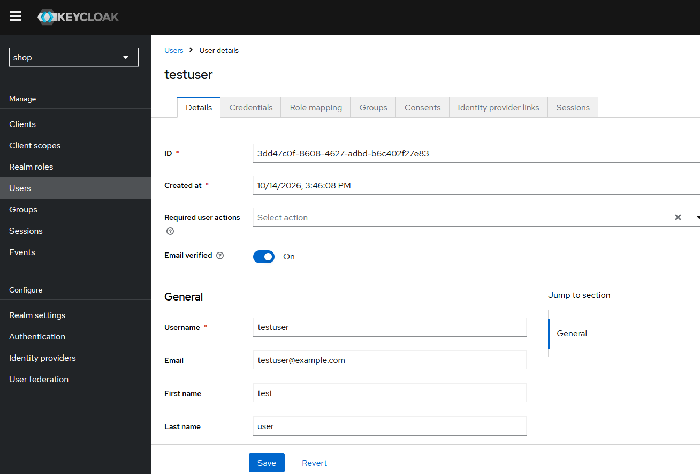
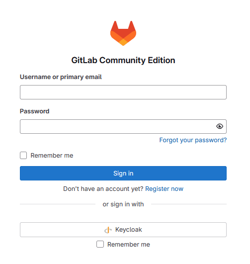
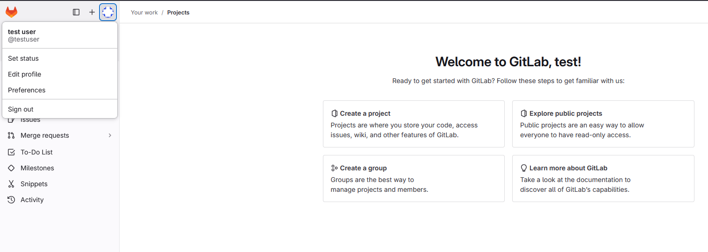
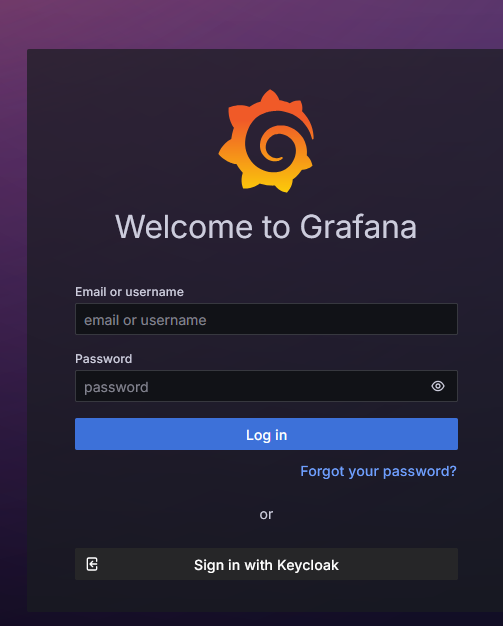
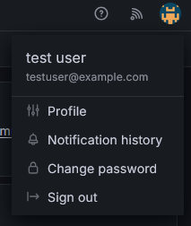

### Часть 2. nginx как рубеж
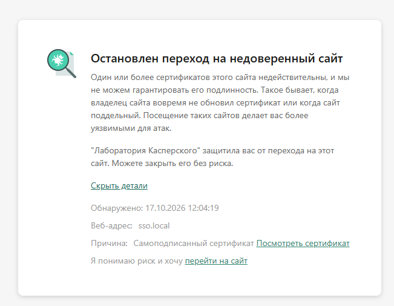
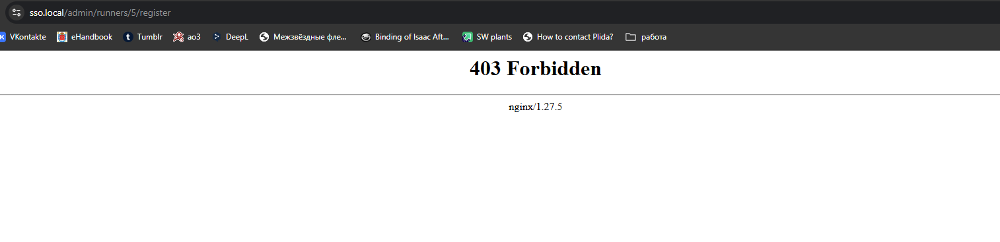
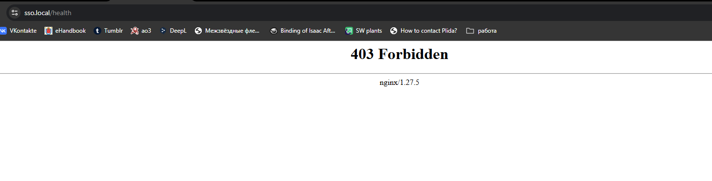

### Часть 3. CI/CD и раннеры
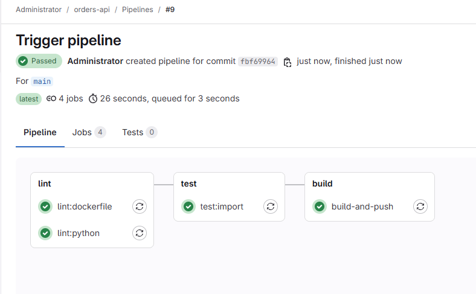
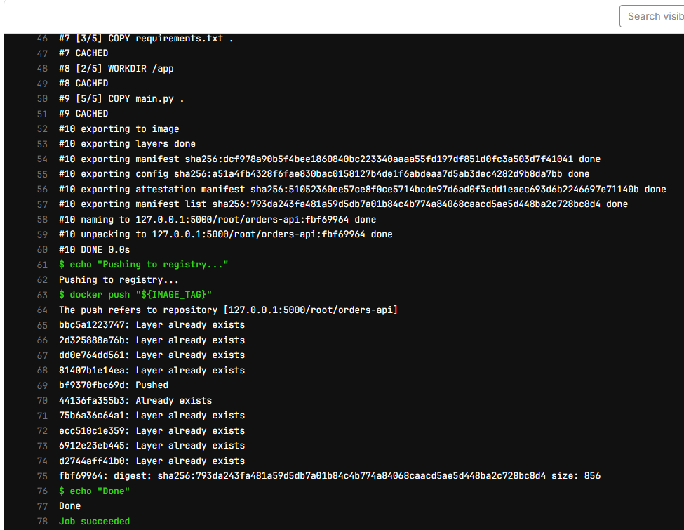
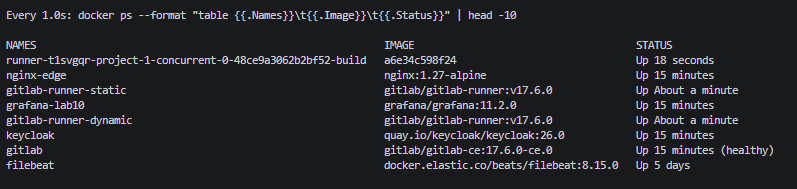
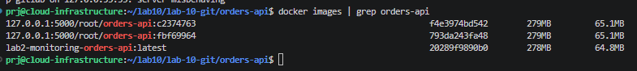

### Часть 4. Мониторинг GitLab
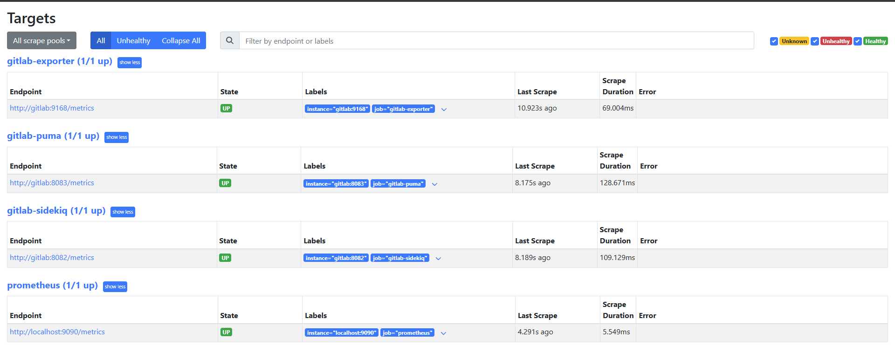
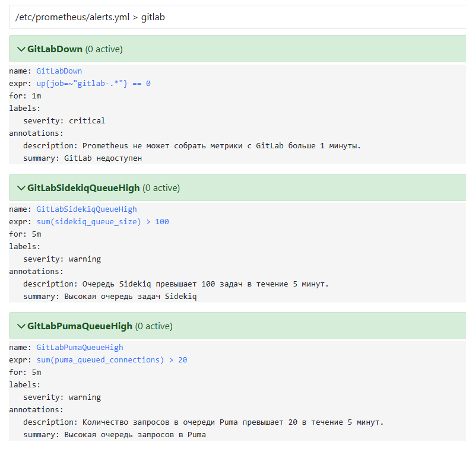
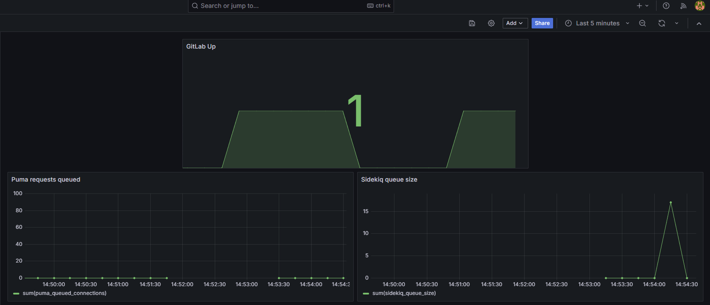