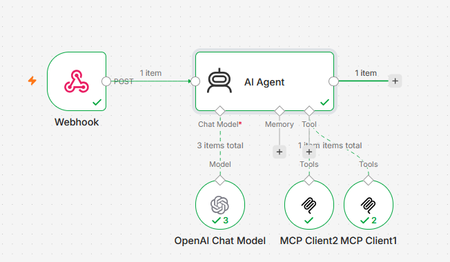
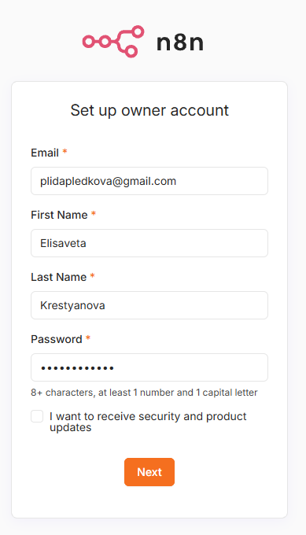
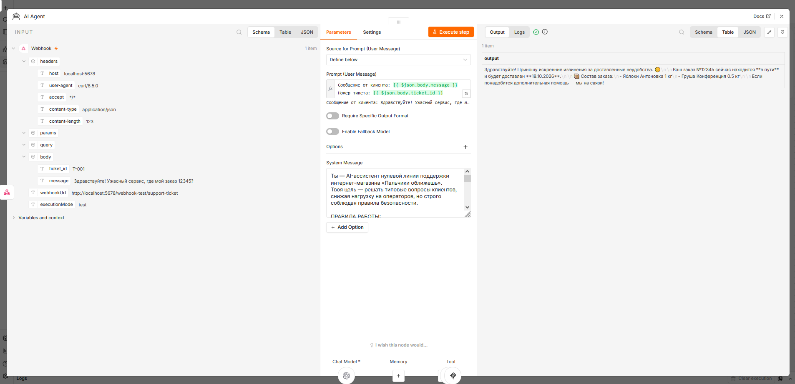
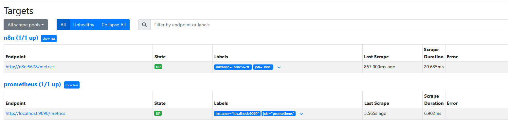
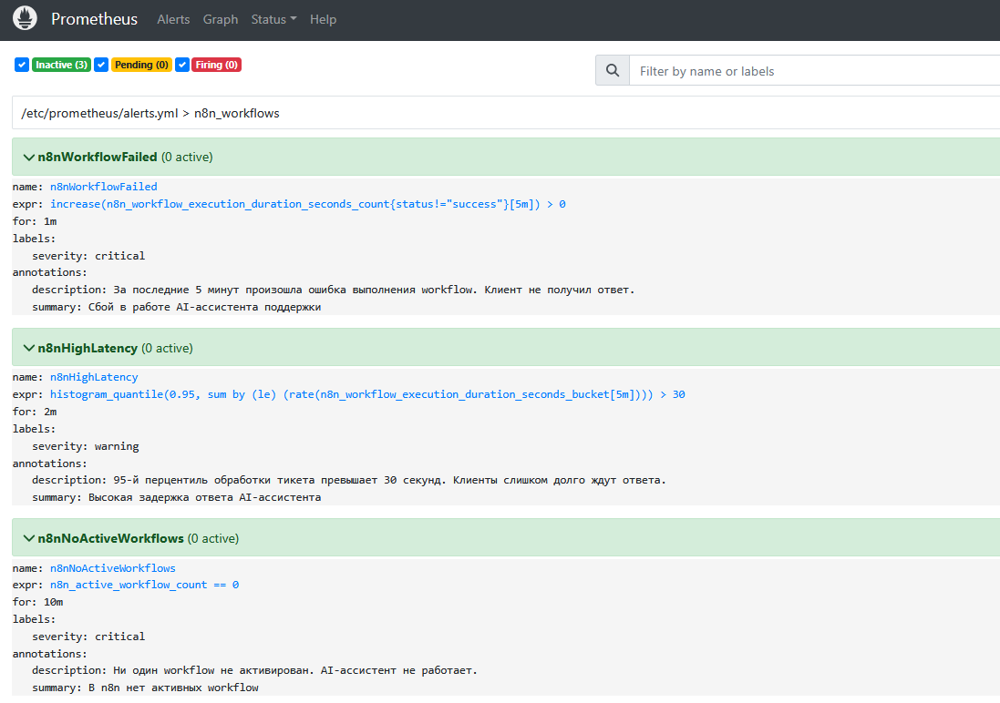
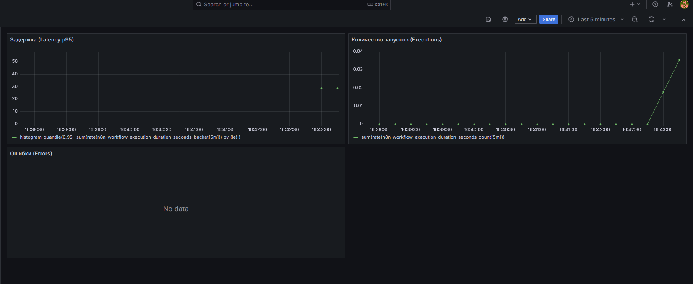

# Lab 12 - Автоматизация поддержки с n8n и AI

Создание AI-ассистента нулевой линии поддержки для интернет-магазина «Пальчики оближешь» с использованием n8n, LLM и MCP-серверов, а также настройка мониторинга.

## Что это

Продолжение Лабы 1. В этой лабе мы автоматизировали процесс обработки обращений в службу поддержки:

- n8n развернут локально через Docker Compose.
- Два MCP-сервера: Filesystem (чтение заказов/FAQ, запись ответов) и Fetch (запросы к мок-сервису логистики).
- AI-агент на базе LLM с описанными skills (правилами).
- Мониторинг нагрузки и ошибок workflow через Prometheus и Grafana.

Вся инфраструктура работает в LXC-контейнере, сервисы общаются через общую Docker-сеть `monitoring-net`.

## Часть 1. Кейс

Проблема: операторы первой линии поддержки тратят до 70% времени на однотипные вопросы («где мой заказ?», «как оплатить?»), что снижает скорость ответа на действительно сложные запросы.

Решение: AI-ассистент берет на себя типовые обращения (нулевая линия). Он анализирует текст, находит заказ, проверяет статус доставки и генерирует вежливый ответ. Если вопрос касается денег, юриспруденции или ответа нет в базе, тикет автоматически эскалируется на живого оператора.

Цепочка работы: Вебхук (новый тикет) -> AI Agent (анализ) -> Проверка заказа (MCP) -> Генерация ответа -> Сохранение в файл (MCP) или Эскалация.

## Часть 2. Архитектура, Toolkit и Skills

В workflow реализованы как AI-шаги, так и обычная логика.

### MCP-серверы
1. `mcp-filesystem` (порт 8000): дает агенту доступ к файлам `/data/orders.json`, `/data/faq.json`, а также позволяет записывать результаты в `/responses/` и `/escalations/`.
2. `mcp-fetch` (порт 8001): позволяет делать HTTP-запросы (используется для получения статуса доставки из мок-сервиса).

### Toolkit (инструменты)
1. `read_file`: читает данные из базы заказов или FAQ.
2. `fetch`: делает GET-запрос к `http://mock-logistics:8080/status?order_id=...`.
3. `write_file`: сохраняет сгенерированный текст ответа в файл `/responses/<ticket_id>.txt`.
4. (Эскалация): создает файл `/escalations/<ticket_id>.json`, если клиенту нужен человек.

### Skills (правила агента)
Агент следует строгому системному промпту:
- Сначала ищет номер заказа в сообщении, читает `orders.json` и запрашивает статус в логистике.
- Если вопроса про заказ нет, ищет ответ в `faq.json`.
- Жесткая эскалация: если речь о возврате денег, юридических вопросах или ответа нет в базе - создать файл эскалации и не отвечать клиенту.
- Эмоциональные жалобы: если вопрос решаем, вежливо извиниться и дать статус заказа.
- Сохранение: всегда вызывать `write_file` перед завершением работы.

### Обработка ошибок для мониторинга
Для проверки алертов в workflow добавлена нода IF: если приходит `ticket_id` со значением `FAIL-001`, процесс намеренно завершается с ошибкой (`Stop and Error`).

## Часть 3. Локальный запуск

Запуск всего стека:
```bash
docker network create monitoring-net   # один раз
cd lab10/lab-12
docker compose up -d
```

Стек включает:
- n8n (порт 5678).
- mock-logistics (порт 8080) - простой Python-сервер, отдающий статусы заказов.
- mcp-filesystem и mcp-fetch (supergateway + SSE).
- Prometheus (порт 9090) и Grafana (порт 3002).

Для подключения MCP-серверов к n8n используется нода `MCP Client Tool` с транспортом `Server Sent Events (Deprecated)`.

## Часть 4. Мониторинг

Дашборд в Grafana (N8n - Lab 12) содержит 3 панели:

1. Executions (Нагрузка):
```promql
sum(rate(n8n_workflow_execution_duration_seconds_count[5m]))
```

2. Latency p95 (Задержка):
```promql
histogram_quantile(0.95, 
  sum(rate(n8n_workflow_execution_duration_seconds_bucket[5m])) by (le)
)
```

3. Errors (Ошибки):
```promql
sum(rate(n8n_workflow_execution_duration_seconds_count{status!="success"}[5m]))
```

### Три алерта

1. n8nWorkflowFailed:
```promql
increase(n8n_workflow_execution_duration_seconds_count{status!="success"}[5m]) > 0
```
Что ловит: любую ошибку выполнения workflow (например, сбой MCP-сервера или отказ LLM).
Чем грозит: клиент остается без ответа, линия поддержки падает.

2. n8nHighLatency:
```promql
histogram_quantile(0.95, sum(rate(n8n_workflow_execution_duration_seconds_bucket[5m])) by (le)) > 30
```
Что ловит: обработка тикета занимает более 30 секунд.
Чем грозит: клиенты слишком долго ждут ответа, растет недовольство.

3. n8nNoActiveWorkflows:
```promql
n8n_active_workflow_count == 0
```
Что ловит: workflow деактивирован и не обрабатывает входящие вебхуки.
Чем грозит: тихий сбой (n8n работает, но тикеты не обрабатываются).

## Как запустить

```bash
cd lab10/lab-12
docker compose up -d --build
docker compose ps
```

Первый запуск занимает пару минут.

## Подключение к серверу

```bash
ssh -L 5678:localhost:5678 \
    -L 3002:localhost:3002 \
    -L 9090:localhost:9090 \
    prj@cloud-infrastructure.yetti
```

| Сервис | Адрес |
|--------|-------|
| n8n | http://127.0.0.1:5678 |
| Grafana | http://127.0.0.1:3002 (admin/admin) |
| Prometheus | http://127.0.0.1:9090 |

## Скриншоты

Схема workflow:


Создание аккаунта в n8n:


Работа AI-агента (лог выполнения):


Targets в Prometheus (все джобы UP):


Алерты в Prometheus:


Дашборд Grafana с метриками нагрузки и ошибок:
