# Lab 8 - ELK и работа с Elasticsearch

Поднятие Elasticsearch + Kibana, заливка логов, поиск и агрегация, ILM + rollover, мониторинг кластера.

## Что это

Продолжение Лабы 1. Логи - то, ради чего DevOps чаще всего поднимает Elasticsearch. В этой лабе:

- Elasticsearch 8.x + Kibana в Docker Compose.
- Индекс с явным маппингом для логов приложения.
- 30 реалистичных логов по предметной области «Пальчики оближешь» через Bulk API.
- Поиски: полнотекстовый, по уровню, по trace_id. Агрегации по level и service.
- ILM + rollover для автоматического управления индексами.
- Мониторинг Elasticsearch через elasticsearch-exporter + Prometheus + Grafana.

Всё развёрнуто через Docker Compose на домашнем сервере, сервисы общаются через общую Docker-сеть `monitoring-net`.

## Что поднято

| Компонент | Роль | Порт |
|-----------|------|------|
| elasticsearch | Хранилище логов и поисковый движок | 9200 |
| kibana | UI для поиска и визуализации | 5601 |
| elasticsearch-exporter | Метрики ES для Prometheus | 9114 |
| Prometheus | Сбор метрик | 9090 |
| Grafana | Визуализация метрик | 3000 |
| Alertmanager | Рассылка алертов | 9093 |

## Как это работает

```text
logs.json  ->  Bulk API  ->  Elasticsearch (shop-logs)  ->  Kibana
```

1. Генерируем 30 реалистичных логов по предметной области.
2. Создаём индекс `shop-logs` с явным маппингом: timestamp (date), level/service/trace_id (keyword), message (text).
3. Заливаем через Bulk API.
4. Ищем и агрегируем через Kibana или REST API.
5. Настраиваем ILM + rollover - ES сам управляет индексами по мере роста.
6. Мониторим кластер через elasticsearch-exporter и Grafana.

## Структура репозитория

```text
lab-8/
├── README.md
├── docker-compose.yml
├── logs.json
├── prometheus/
│   ├── prometheus.yml
│   └── alerts.yml
├── alertmanager/
│   └── alertmanager.yml
└── screenshots/
    ├── status-yellow.png
    ├── заливка.png
    ├── request-1.png
    ├── request-2.png
    ├── request-3.png
    ├── request-4.png
    ├── ilm.png
    ├── start-index.png
    ├── rollover.png
    ├── rollover-result.png
    ├── elastic-lens.png
    ├── grafana.png
    └── prometheus.png
```

## Как запустить

```bash
docker network create monitoring-net   # один раз
cd lab-8
docker compose up -d --build
docker compose ps
```

Первый запуск - 1-2 минуты.

## Подключение к серверу

```bash
ssh -L 19090:localhost:9090 \
    -L 13000:localhost:3000 \
    -L 19093:localhost:9093 \
    -L 19200:localhost:9200 \
    -L 15601:localhost:5601 \
    -L 19114:localhost:9114 \
    prj@cloud-infrastructure.yetti
```

| Сервис | Адрес |
|--------|-------|
| Elasticsearch | http://127.0.0.1:19200 |
| Kibana | http://127.0.0.1:15601 |
| Prometheus | http://127.0.0.1:19090 |
| Grafana | http://127.0.0.1:13000 (admin/admin) |
| Alertmanager | http://127.0.0.1:19093 |

## Что дальше

- Поднятие Elasticsearch + Kibana, проверка статуса кластера.
- Индекс с явным маппингом, заливка 30 логов через Bulk API.
- Поиски: полнотекстовый, по level + диапазон, по trace_id. Агрегация по level.
- ILM-политика + index template + alias, rollover.
- Мониторинг ES: дашборд Grafana, 3 алерта.

Подробное описание каждой части и обоснование алертов - в [report.md](report.md).

## Скриншоты

### Часть 1. Развёртывание ELK

Статус кластера yellow (ситуация, когда индекс создан с rep=1):

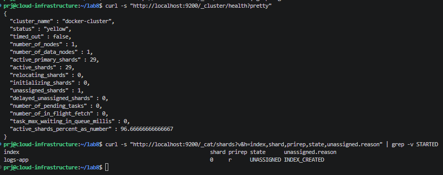

### Часть 2. Данные, индекс и поиск

Заливка логов:

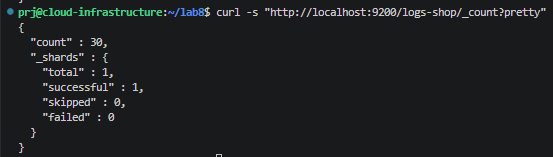

Полнотекстовый поиск:

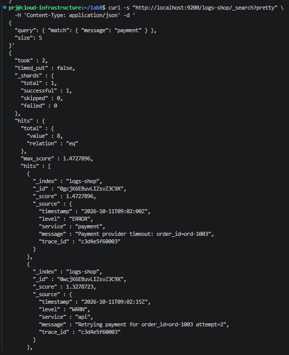

Фильтр по level + диапазон:

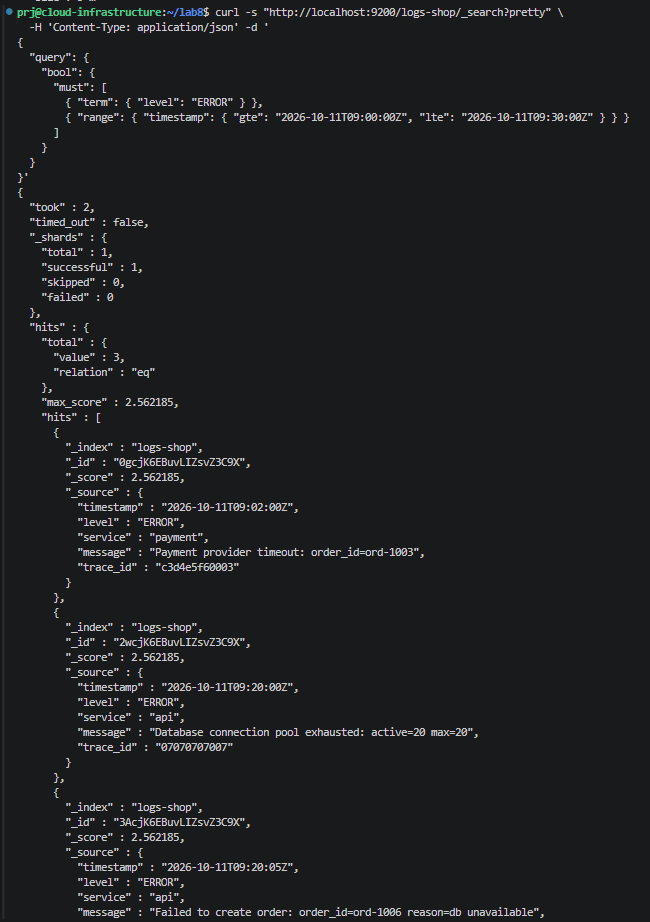

Поиск по trace_id:

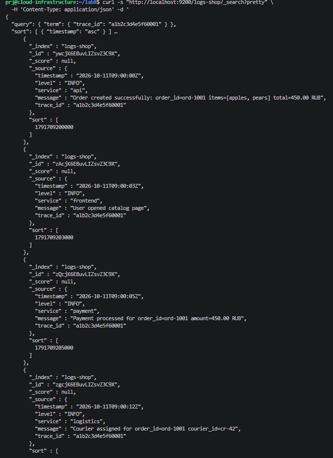

Агрегация по level:

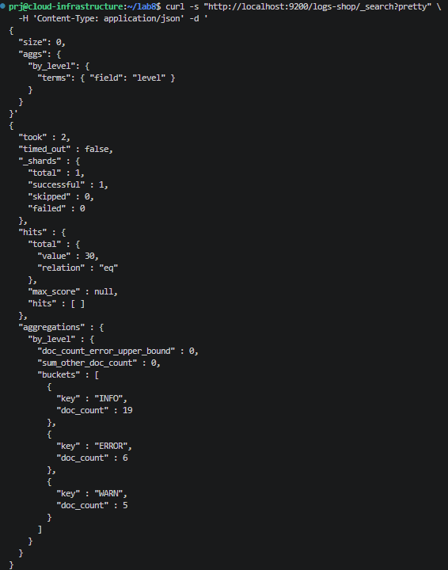

### Часть 3. ILM + rollover

ILM-политика и template:

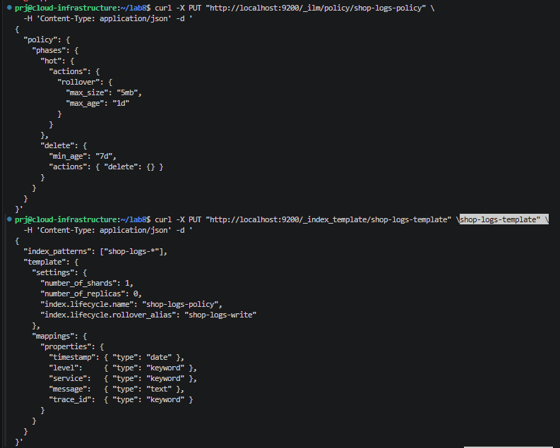

Начальный индекс с alias:

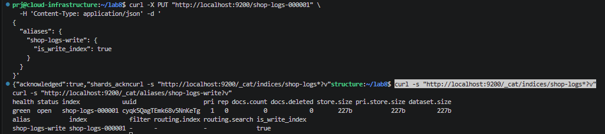

Rollover:

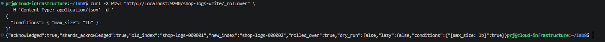

Результат rollover:

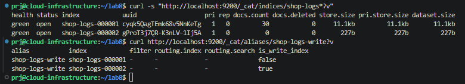

### Часть 4. Мониторинг

Визуализация в Kibana:

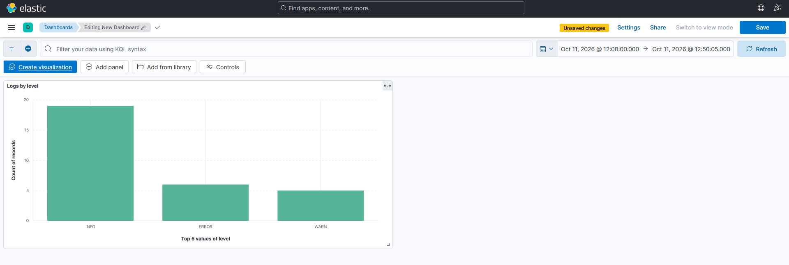

Дашборд Grafana:

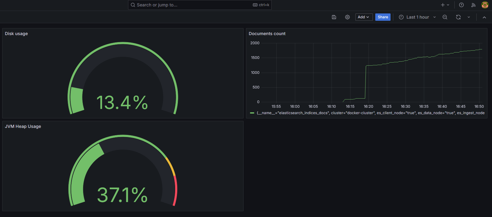

Алерты в Prometheus:

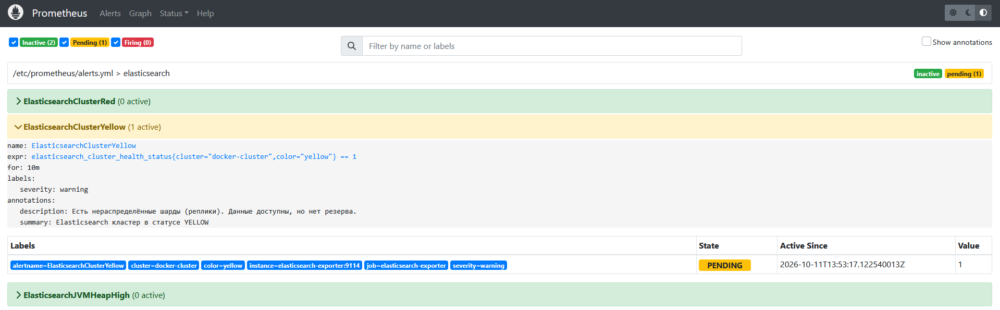